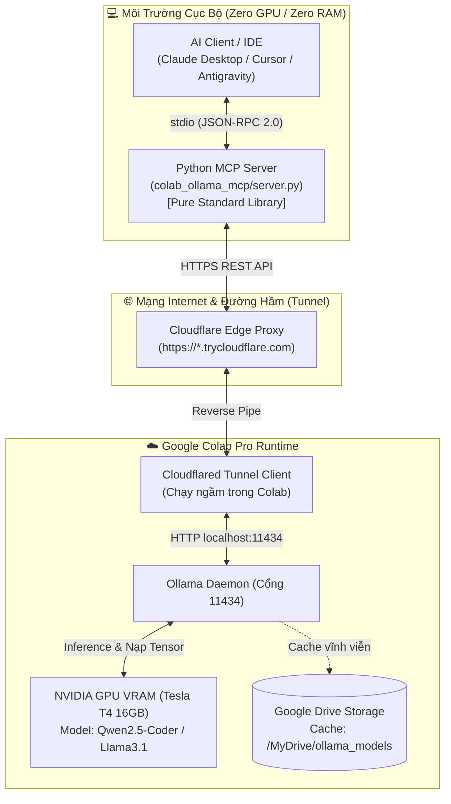

# 🦙 Colab Ollama MCP

> **Chạy Ollama trên GPU Google Colab Pro và điều khiển trực tiếp từ máy cục bộ qua Model Context Protocol (MCP) — 0% tải RAM & GPU máy cá nhân.**

[](https://www.python.org/)
[](LICENSE)
[](https://modelcontextprotocol.io/)

---

## 💡 Đặt Vấn Đề & Giá Trị Thực Tiễn (Business & ROI)

Việc chạy các mô hình ngôn ngữ lớn nguồn mở (như **Qwen 2.5 Coder 7B/14B**, **Llama 3.1 8B**, **DeepSeek-R1 8B**) trực tiếp trên máy tính cá nhân thường gặp trở ngại lớn:
- **Đòi hỏi phần cứng đắt tiền:** Cần tối thiểu GPU 12GB - 16GB VRAM (như RTX 3060/4060Ti, hoặc Mac Apple Silicon với RAM $\ge 36\text{GB}$ giá 40 - 80 triệu VNĐ).
- **Máy văn phòng / Ultrabook mỏng nhẹ:** Thường chỉ có 8GB - 16GB RAM chia sẻ, quạt quay rú ồn ào và máy nhanh nóng, pin tụt nhanh.

### 💰 Bảng So Sánh Chi Phí & ROI

| Lựa Chọn | Chi Phí Ban Đầu (CapEx) | Chi Phí Hằng Tháng (OpEx) | Thời Lượng / Khả Năng Sử Dụng | Mức Độ Riêng Tư |
| :--- | :--- | :--- | :--- | :--- |
| **Google Colab Pro** | **0 VNĐ** | **~$10 / tháng (~250k VNĐ)** | ~50 - 65 giờ chạy GPU Tesla T4 16GB VRAM | ✅ Môi trường VM riêng |
| **Mua PC GPU RTX 4060Ti / 3090** | 15 - 35 triệu VNĐ | Tiền điện (~100k - 200k/th) | 24/7 không giới hạn | ✅ 100% Offline |
| **Macbook Pro 36GB - 64GB RAM** | 45 - 80 triệu VNĐ | Tiền điện không đáng kể | 24/7 | ✅ 100% Offline |
| **Thuê Cloud GPU (RunPod/Vast.ai)** | 0 VNĐ | ~$0.20 - $0.40 / giờ | Trả theo giờ (quên tắt tính tiền liên tục) | ✅ Container riêng |
| **API Thương Mại (Claude / OpenAI)** | 0 VNĐ | Phụ thuộc lượng token dùng | Trả tiền theo mỗi triệu tokens gọi ra | ⚠️ Gửi data lên server vendor |

👉 **Kết luận:** **Colab Pro + Ollama + MCP** là điểm giao thoa kinh tế tối ưu cho lập trình viên, sinh viên và chuyên viên dữ liệu muốn vọc vạch mô hình AI mới mỗi ngày mà không phải chi số tiền lớn mua máy mới.

---

## 🏛️ Sơ Đồ Kiến Trúc Hệ Thống (Architecture)



---

## ⚡ Hướng Dẫn Nhanh: 3 Bước Bắt Đầu (Quickstart)

### Bước 1: Mở Notebook trên Google Colab
1. Tải file [`notebooks/colab_ollama_mcp.ipynb`](notebooks/colab_ollama_mcp.ipynb) lên Google Colab hoặc mở trực tiếp trên Google Drive.
2. Chọn menu **Runtime** $\rightarrow$ **Change runtime type** $\rightarrow$ Chọn **T4 GPU**.
3. Nhấn **Runtime** $\rightarrow$ **Run all**.
4. Khi chạy xong Cell số 5, màn hình sẽ in ra đường hầm dạng:
   ```
   =================================================================
   🎉 CHÚC MỪNG! ĐƯỜNG HẦM OLLAMA ĐÃ HOẠT ĐỘNG:
   🔗 TUNNEL URL: https://random-name.trycloudflare.com
   =================================================================
   ```

### Bước 2: Cài Đặt MCP Server Trên Máy Cục Bộ
MCP server được lập trình hoàn toàn bằng thư viện chuẩn của Python (không yêu cầu cài thêm package bên thứ ba nào):
```bash
# Kiểm tra kết nối thử tới URL đường hầm của bạn
python3 colab_ollama_mcp/server.py --endpoint https://random-name.trycloudflare.com --test
```

### Bước 3: Cấu Hình IDE Của Bạn (Claude Desktop / Cursor / Antigravity)

#### Dành cho Claude Desktop:
Mở file `~/Library/Application Support/Claude/claude_desktop_config.json` (macOS) hoặc `%APPDATA%\Claude\claude_desktop_config.json` (Windows) và thêm:
```json
{
  "mcpServers": {
    "colab-ollama": {
      "command": "python3",
      "args": [
        "/Users/marchhygge/MarchHygge/project/colab-ollama-mcp/colab_ollama_mcp/server.py",
        "--endpoint",
        "https://random-name.trycloudflare.com"
      ]
    }
  }
}
```

#### Dành cho Cursor IDE:
Vào **Cursor Settings** $\rightarrow$ **Features** $\rightarrow$ **MCP Servers** $\rightarrow$ **Add New MCP Server**:
- **Name:** `colab-ollama`
- **Type:** `command`
- **Command:** `python3 /Users/marchhygge/MarchHygge/project/colab-ollama-mcp/colab_ollama_mcp/server.py --endpoint https://random-name.trycloudflare.com`

---

## 🛠️ Danh Sách MCP Tools Hỗ Trợ

| Tên Tool | Mô Tả |
| :--- | :--- |
| `ollama_chat` | Gửi prompt chat / phân tích code tới model trên Colab. Trả về câu trả lời kèm thống kê tốc độ sinh token ($tps$) và độ trễ ($ms$). |
| `ollama_generate` | Sinh nội dung / completion từ raw prompt. |
| `ollama_list_models` | Xem danh sách các model đang có sẵn trong Colab GPU. |
| `ollama_status` | Kiểm tra độ trễ mạng tới Colab, trạng thái kết nối và model nào đang nạp trong VRAM. |
| `ollama_pull_model` | Ra lệnh từ xa để Colab kéo thêm model mới (ví dụ `deepseek-r1:8b`). |

---

## 📚 Kho Kiến Thức Chuyên Sâu (Obsidian Knowledge Base)
Dự án được tài liệu hóa chi tiết trong Obsidian Knowledge Base tại `.agents/knowledge-base/`:
- `01-architecture/ARC-01 System Overview.md`: Kiến trúc và luồng dữ liệu chi tiết.
- `01-architecture/ARC-02 Security & Tunneling.md`: Phân tích bảo mật, so sánh Cloudflare vs ngrok.
- `02-colab-runtime/COLAB-01 Bootstrap & Ollama Setup.md`: Cơ chế VRAM, lượng tử hóa 4-bit và Google Drive cache.
- `02-colab-runtime/COLAB-02 Keep-Alive Strategies.md`: Chiến lược chống ngủ Colab (anti-idle) bằng âm thanh vô thanh.
- `02-colab-runtime/COLAB-03 Cloudflare Tunnel Automation.md`: Tự động hóa lấy URL Quick Tunnel.
- `03-mcp-server/MCP-01 FastMCP Server Design.md`: Chuẩn JSON-RPC 2.0 stdio và thiết kế zero-dependency.
- `03-mcp-server/MCP-02 Client Configuration & Tool Schemas.md`: Hướng dẫn cấu hình đa nền tảng.
