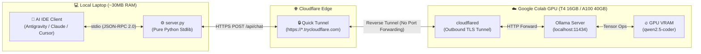
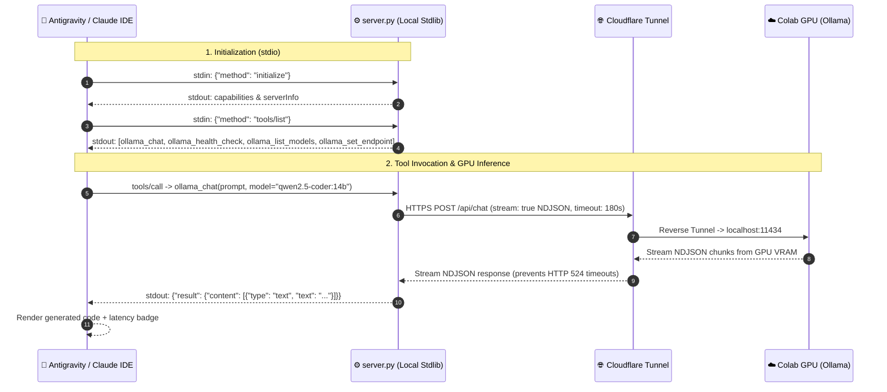
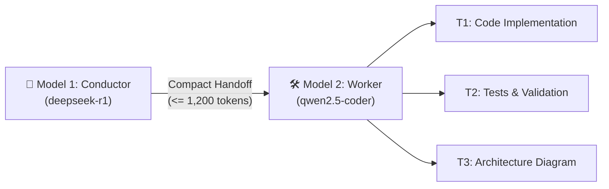

# 🦙 Colab Ollama MCP

> **Zero-Dependency Model Context Protocol (MCP) Bridge to Google Colab GPUs — Run `qwen2.5-coder:14b` & `32b` directly inside Antigravity IDE, Claude Desktop, and Cursor with 0% local model RAM overhead.**

[-blue.svg)](https://www.python.org/)
[-purple.svg)](https://modelcontextprotocol.io/)
[](https://colab.research.google.com/)
[](LICENSE)

---

## 📖 Table of Contents
1. [Overview & Architecture](#-1-overview--architecture)
2. [Notebook Suite: Plan 1 vs. Plan 2](#-2-notebook-suite-plan-1-vs-plan-2)
3. [Repository Structure](#-3-repository-structure)
4. [Documentation](#-4-documentation)
5. [Quickstart Setup Guide](#-5-quickstart-setup-guide)
   - [Way 1: Drop Link into IDE Chat](#-way-1-drop-the-tunnel-url-directly-into-chat-instant)
   - [Way 2: Terminal One-Liner](#-way-2-run-the-cli-helper-command)
   - [Running in IDE vs. Web Browser](#running-directly-in-ide-vs-browser-fallback)
6. [Available MCP Tools](#-6-available-mcp-tools)
7. [Conductor & Worker Protocol (Dual-Resident VRAM)](#-7-conductor--worker-protocol-dual-resident-vram)
8. [Inference Verification & FAQ](#-8-inference-verification--faq)
9. [Interactive Explainer](#-9-interactive-explainer)

---

## 💡 1. Overview & Architecture

### The Problem & Solution
- **The Bottleneck:** Commercial cloud API quotas exhaust mid-sprint, while running 14B–32B coding models locally consumes 10GB–22GB of unified RAM—throttling laptops and draining battery.
- **The Solution:** Offload 100% of GPU matrix compute to a remote Google Colab GPU (**Tesla T4 16GB** or **A100 40GB**) over a Cloudflare Quick Tunnel, while keeping local client footprint under **~30 MB RAM** via a single stdlib Python MCP server ([`colab_ollama_mcp/server.py`](colab_ollama_mcp/server.py)).

| Approach | Hardware Cost | Monthly Cost | Local Laptop RAM | Stays Inside IDE | Coding Capability |
| :--- | :---: | :---: | :---: | :---: | :--- |
| **Colab Ollama MCP (This Repo)** | **$0** | **$0 – $10/mo** | **~30 MB** | ✅ Yes | **High (`14B` / `32B`)** |
| **Local LLM on 16–18GB Mac** | $0 | $0 | **10 GB – 14 GB** *(throttles system)* | ✅ Yes | Medium (`7B`–`8B`) |
| **Dedicated GPU Workstation** | $2,000 – $4,000 | Electricity | 16 GB+ | ✅ Yes | High |
| **Cloud APIs (Pay-per-token)** | $0 | Variable / Quota-limited | 0 MB | ✅ Yes | High |

### System Architecture



### End-to-End Data Flow



---

## 🚀 2. Notebook Suite: Plan 1 vs. Plan 2

Choose the notebook profile matching your Colab Compute Unit (CU) budget and performance needs:

| Profile | Notebook | GPU & Rate | Models & Architecture | Best For |
| :--- | :--- | :--- | :--- | :--- |
| **Tutorial** | [`notebooks/colab_ollama_tutorial.ipynb`](notebooks/colab_ollama_tutorial.ipynb) | **Tesla T4 (16GB)**<br>`~1.53 CU/h` | **`qwen2.5-coder:14b`** | Quick setup verification & single-model testing. |
| **Plan 1: Performance (T4)** | [`notebooks/colab_ollama_plan1_performance_t4.ipynb`](notebooks/colab_ollama_plan1_performance_t4.ipynb) | **Tesla T4 (16GB)**<br>`~1.53 CU/h` | **`deepseek-r1:14b`** (Planner) + **`qwen2.5-coder:14b`** (Worker)<br>*82% VRAM, ~1.8s swap via 16GB NVMe swap* | High-quality reasoning and coding when `CU > 35`. |
| **Plan 1: Performance (A100)** | [`notebooks/colab_ollama_plan1_performance_a100.ipynb`](notebooks/colab_ollama_plan1_performance_a100.ipynb) | **NVIDIA A100 (40GB)**<br>`~5.38 CU/h` | **Dual-Resident (`0.0s` switch)**: `deepseek-r1:14b` + `qwen2.5-coder:32b` (or `qwen3-coder:30b` MoE) | Complex architectural sprints & deep debugging. |
| **Plan 2: Fast (T4 Dual-Resident)** | [`notebooks/colab_ollama_plan2_fast_t4.ipynb`](notebooks/colab_ollama_plan2_fast_t4.ipynb) | **Tesla T4 (16GB)**<br>`~1.53 CU/h` | **Dual-Resident (`0.0s` switch)**: `deepseek-r1:8b` + `qwen2.5-coder:7b` (or `qwen3-coder:8b`)<br>*80.2% VRAM (12.7 / 15.84 GB)* | Low CU budget (`< 35 CU`) or ultra-fast 65–75 tok/s coding. |

---

## 📂 3. Repository Structure

```text
colab-ollama-mcp/
├── colab_ollama_mcp/
│   ├── __init__.py                  # Package metadata
│   └── server.py                    # Zero-dependency MCP server (pure Python stdlib)
├── notebooks/
│   ├── colab_ollama_tutorial.ipynb               # Starter single-model runner
│   ├── colab_ollama_plan1_performance_t4.ipynb   # Plan 1 (T4): deepseek-r1:14b + qwen2.5-coder:14b
│   ├── colab_ollama_plan1_performance_a100.ipynb # Plan 1 (A100): Dual-resident 14b + 32b
│   └── colab_ollama_plan2_fast_t4.ipynb          # Plan 2 (T4): Dual-resident 8b + 7b (0.0s switch)
├── configs/
│   ├── antigravity_mcp_config.json  # MCP config template for Antigravity IDE
│   ├── claude_desktop_config.json   # MCP config template for Claude Desktop
│   ├── cursor_mcp.json              # MCP config template for Cursor IDE
│   └── .env.example                 # Environment variable reference
├── tests/
│   └── test_server.py               # Stdlib unittest suite for MCP server & JSON-RPC
├── docs/
│   ├── architecture.md              # System architecture, stdio protocol & tunnel design
│   ├── conductor-worker.md          # Conductor-Worker subagent protocol & state handoff
│   ├── colab-runtime.md             # Colab GPU provisioning, swapfile & keep-alive
│   ├── model-selection.md           # Model matrix, CU budget tradeoffs & quant profiles
│   └── explainer.html               # Interactive HTML visual guide & packet debugger
├── pyproject.toml                   # Python packaging metadata
└── README.md                        # Project documentation
```

---

## 📚 4. Documentation

Comprehensive technical guides, architectural specifications, and interactive visual aids are available in the [`docs/`](docs/) directory:

| Guide | Focus Area | Description |
| :--- | :--- | :--- |
| [**Architecture & System Flow**](docs/architecture.md) | Architecture (`ARC-01`) | Pure stdlib MCP server design, JSON-RPC 2.0 stdio transport, Cloudflare Quick Tunnel routing, and end-to-end packet latency mechanics. |
| [**Conductor & Worker Protocol**](docs/conductor-worker.md) | Agent Orchestration (`ARC-04`) | State handoff contract (`HANDOFF.md`), dual-resident VRAM pinning (`OLLAMA_MAX_LOADED_MODELS=2`), zero-overhead model switching, and KV cache prefix reuse. |
| [**Colab Runtime & GPU Provisioning**](docs/colab-runtime.md) | Cloud Infrastructure (`COLAB-01`) | Tesla T4 vs. A100 environment setup, 16GB NVMe swapfile OOM protection, background keep-alive daemons, and headless tunnel lifecycle management. |
| [**Model Selection Matrix**](docs/model-selection.md) | Compute & Models | Compute Unit (CU) budget allocation, Plan 1 Performance vs. Plan 2 Fast profiles, `Q4_K_M` quantizations, and context window limits. |
| [**Interactive Visual Explainer**](docs/explainer.html) | Visual Explainer & Debugger | Standalone HTML web application featuring dynamic tradeoff matrices, packet-level sequence simulators, and interactive code inspectors (`open docs/explainer.html`). |

---

## ⚡ 5. Quickstart Setup Guide

### Step 1: Launch Notebook on Colab GPU
1. Open your chosen notebook in **Antigravity IDE** (via the Google Colab extension) or at [colab.research.google.com](https://colab.research.google.com/).
2. Select GPU runtime: **T4** or **A100**.
3. Click **Run All** (`▶️▶️`). In ~2 minutes, the notebook provisions the 16GB NVMe swapfile, starts Ollama with Flash Attention, pulls the models, and prints your Cloudflare Tunnel URL:
   ```text
   https://xxxx-xxxx.trycloudflare.com
   ```

### Step 2: Connect to MCP Server (Choose Way 1 or Way 2)

#### 🚀 Way 1: Drop the Tunnel URL Directly into Chat (Instant)
Paste the raw `https://xxxx-xxxx.trycloudflare.com` URL straight into your active IDE / `agy` chat.
The agent invokes `ollama_set_endpoint`, updates `mcp_config.json`, performs a live latency health check, and hot-switches inference immediately.

#### ⚡ Way 2: Run the CLI Helper Command
Run the command printed by the notebook in your project root:
```bash
python3 colab_ollama_mcp/server.py --set-endpoint https://xxxx-xxxx.trycloudflare.com
```

```text
✅ Updated MCP config: ~/.gemini/config/mcp_config.json
🎉 ONLINE & SWITCHED! Connected to Colab GPU at https://xxxx-xxxx.trycloudflare.com (185 ms).
Active Models: qwen2.5-coder:14b, deepseek-r1:14b
```

> **Zero Restart Required:** `server.py` reloads the active endpoint dynamically on every tool call. You never need to reload your IDE or restart running CLI processes.

### Running Directly in IDE vs. Browser Fallback
- **⭐ Antigravity IDE (Recommended — 0 MB Browser RAM):** Connect to Colab directly inside the IDE via *Select Kernel $\rightarrow$ Colab*. Monitor live GPU VRAM and system metrics directly in the IDE Activity Bar (`CO` icon). Close all browser tabs to save 2–4 GB local RAM.
- **Web Browser Fallback:** If using a browser, **Safari** uses only ~300 MB RAM compared to Chrome's 2.5–3.9 GB. If using Chrome, add `https://colab.research.google.com` to `chrome://settings/performance` under *Always keep these sites active* to prevent background tab discarding.

---

## 🛠️ 6. Available MCP Tools

The local MCP server exposes 4 tools via JSON-RPC 2.0 stdio:

| Tool Name | Parameters | Description |
| :--- | :--- | :--- |
| **`ollama_chat`** | `prompt` *(str, required)*<br>`system` *(str, optional)*<br>`model` *(str, optional)*<br>`temperature` *(float, default: 0.2)* | Sends a coding, refactoring, or review prompt to the remote Colab GPU and returns the output with execution latency. |
| **`ollama_health_check`** | *(none)* | Tests tunnel round-trip latency (ms), verifies remote Ollama daemon responsiveness, and lists VRAM-pinned models. |
| **`ollama_list_models`** | *(none)* | Queries `GET /api/tags` and returns all downloaded models with sizes. |
| **`ollama_set_endpoint`** | `endpoint` *(str, required)* | Dynamically updates endpoint URL in MCP configuration, validates connectivity, and hot-switches active session. |

---

## 🎼 7. Conductor & Worker Protocol (Dual-Resident VRAM)

To eliminate the **15–40s model reload penalty** and KV cache evictions, the architecture separates planning from execution:



1. **Conductor (`deepseek-r1`):** Runs once per feature to analyze requirements with `<think>` CoT reasoning and output a pre-sliced checklist into `.agents/kb/HANDOFF.md` ($\le 1,200$ tokens).
2. **Worker (`qwen2.5-coder`):** Executes tasks sequentially (`T1 -> Tn`) with **100% KV Cache prefix reuse** (`< 0.15s` prefill) and **0 model swaps**.
3. **Dual-Residency (`OLLAMA_MAX_LOADED_MODELS=2`):**
   - **Plan 1 (A100 40GB):** Both `deepseek-r1:14b` (~9 GB) and `qwen2.5-coder:32b` (~20 GB) remain pinned in VRAM simultaneously (`0.0s` switch latency).
   - **Plan 2 (T4 16GB):** Both `deepseek-r1:8b` (~5.2 GB) and `qwen2.5-coder:7b` (~4.5 GB) stay pinned in VRAM (`12.7 / 15.84 GB`, `0.0s` switch latency).

### Built-In Safeguards
- **16GB NVMe Swapfile:** Prevents Colab Linux OOM killer by expanding virtual memory to 28.67 GB.
- **Flash Attention & `q8_0` KV Cache:** Halves VRAM context usage across all models.
- **Cloudflared Pipe Drain Daemon:** Drains background stdout to prevent OS pipe deadlocks during marathon coding sessions.

---

## 🔍 8. Inference Verification & FAQ

### Host Orchestrator vs. Remote GPU Worker
Your IDE agent (Gemini, Claude, or local reasoning model) serves as the **Host Orchestrator** managing files and planning. When coding tasks are delegated, matrix math runs remotely on the **Colab GPU Worker**.

Every remote response includes an execution signature verifying GPU offload:
```text
🦙 [Inference: qwen2.5-coder:14b @ Colab GPU | 100% VRAM]
[⏱️ Completed in 9.86s via Colab GPU (qwen2.5-coder:14b)]
```

### Quick Verification & Troubleshooting

- **Check Tunnel & VRAM Status:**
  In IDE chat: *"Run `ollama_health_check`."*
  ```text
  🟢 ONLINE: Connected to Colab Ollama at https://*.trycloudflare.com
  ⚡ Tunnel Latency: 185 ms
  🔥 Active Models Pinned in Colab GPU VRAM (/api/ps):
     • qwen2.5-coder:14b [Q4_K_M] — VRAM Used: 14.26 GB / 14.26 GB (100% GPU offload)
  ```
- **Verify on Colab VM:** Run `!nvidia-smi` in the notebook to view `ollama_runners` memory allocation.
- **Cloudflare 524 Timeout:** Handled automatically—`server.py` requests streamed NDJSON (`stream: true`) to maintain active connection packets.

---

## 🎓 9. Interactive Explainer

For a comprehensive interactive walkthrough covering the entire pipeline from business motivation to line-by-line OS pipe mechanics:

```bash
open docs/explainer.html
```

- **Interactive Tradeoff Matrix:** Dynamic comparison of fallback strategies when quotas run out.
- **Packet-Level Sequence Simulator:** 9-step timeline demonstrating JSON-RPC stdio exchange and reverse tunnel mechanics.
- **Line-by-Line Code Walkthrough:** Annotated breakdown of all core functions in `server.py`.
