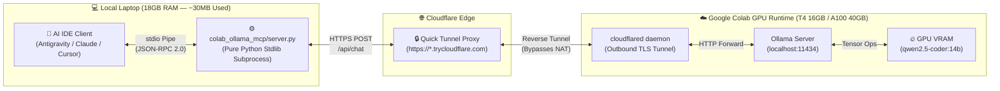
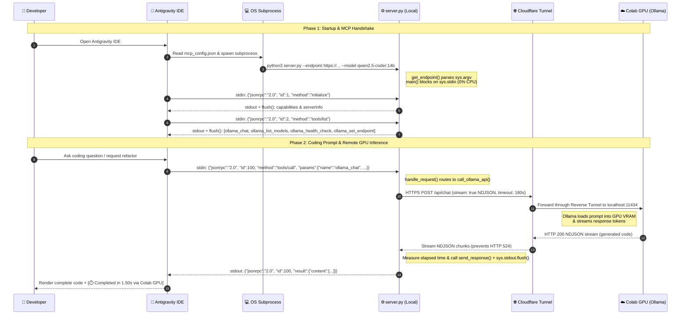

# 🦙 Colab Ollama MCP

> **Zero-Dependency Model Context Protocol (MCP) Bridge to Google Colab GPUs — Run `qwen2.5-coder:14b` & `32b` Directly Inside Antigravity IDE, Claude Desktop, and Cursor with 0% Local Model RAM Overhead.**

[-blue.svg)](https://www.python.org/)
[-purple.svg)](https://modelcontextprotocol.io/)
[](https://colab.research.google.com/)
[](LICENSE)

---

## 📖 Table of Contents
1. [Business Problem & Why This Exists](#-1-business-problem--why-this-exists)
2. [Model Selection: Why `qwen2.5-coder:14b` ⭐](#-2-model-selection-why-qwen25-coder14b-)
3. [System Architecture & End-to-End Technical Flow](#-3-system-architecture--end-to-end-technical-flow)
4. [Repository Structure](#-4-repository-structure)
5. [Step-by-Step Setup & Execution Guide](#-5-step-by-step-setup--execution-guide)
   - [Option A (⭐ Recommended — 0 MB Browser RAM): Run Directly Inside Antigravity IDE](#option-a--recommended--0-mb-browser-ram-run-directly-inside-antigravity-ide)
   - [Option B (Web Browser Fallback): Safari vs. Chrome RAM Optimization](#option-b-web-browser-fallback-safari-vs-chrome-ram-optimization)
6. [Available MCP Tools](#-6-available-mcp-tools)
7. [Interactive Explainer & Knowledge Base](#-7-interactive-explainer--knowledge-base)
8. [Model Switching & Inference Verification (FAQ & Best Practices)](#-8-model-switching--inference-verification-faq--best-practices)
9. [Conductor & Worker Subagent Protocol (State Handoff)](#-9-conductor--worker-subagent-protocol-state-handoff)

---

## 💡 1. Business Problem & Why This Exists

### The Problem
Modern AI-assisted development inside IDEs (like **Antigravity**, **Claude Desktop**, and **Cursor**) relies heavily on commercial cloud APIs. Developers routinely hit three bottlenecks:
1. **Unexpected Quota / Token Exhaustion:** Rate limits and token caps run out mid-sprint right before a deadline.
2. **Local Hardware Constraints (16GB–18GB Laptop RAM):** Running capable coding models (14B–32B parameters) locally consumes 10GB–22GB of unified memory, starving the OS, IDE, and containers while draining battery and overheating the laptop.
3. **Context-Switching Friction:** Copy-pasting code back and forth between an IDE and an external web chat breaks developer flow.

### The Solution
**Colab Ollama MCP** decouples **IDE orchestration** (local laptop) from **heavy GPU inference** (Google Colab Cloud GPU):
- **100% of LLM weights and matrix computations** run inside Google Colab's NVIDIA GPU VRAM (**Tesla T4 16GB** or **A100 40GB**).
- **Local resource footprint is ~30 MB RAM** — handled by a single, zero-dependency Python script (`colab_ollama_mcp/server.py`) using only the Python standard library.
- **Native IDE integration** via the **Model Context Protocol (MCP)**: your IDE calls the remote GPU as a native tool (`ollama_chat`) without leaving your editor.

### Cost & Hardware ROI Comparison

| Approach | Upfront Hardware Cost | Monthly Cost | Local Laptop RAM Used | Stays Inside IDE | Coding Quality |
| :--- | :---: | :---: | :---: | :---: | :--- |
| **Colab Pro + Ollama MCP (This Repo)** | **$0** | **$0 – $10/mo** *(existing Colab plan)* | **~30 MB** | ✅ Yes | **High (`14B` / `32B`)** |
| **Local LLM on 18GB Laptop** | $0 | $0 | **10 GB – 14 GB** *(throttles system)* | ✅ Yes | Medium–High |
| **Dedicated GPU Workstation / 64GB Mac** | $2,000 – $4,000 | Electricity | 16 GB+ | ✅ Yes | High |
| **Pay-Per-Token Cloud APIs** | $0 | Variable / Unpredictable | 0 MB | ✅ Yes | Very High |

---

## 🧠 2. Model Selection: Why `qwen2.5-coder:14b` ⭐

Because the model loads into **Google Colab's GPU VRAM** (and *not* your laptop's 18GB RAM), you can run mid-to-large open-weight coding models that significantly outperform lightweight cloud Flash models:

| Model Tag | VRAM Required | Recommended Colab GPU | Coding Quality vs. Gemini Flash | Generation Speed | Best Use Case |
| :--- | :---: | :---: | :--- | :---: | :--- |
| **`qwen2.5-coder:14b` ⭐**<br>*(Default & Recommended)* | **~9.5 GB** | **Tesla T4 (16GB)**<br>*(Low Compute Units)* | **Outperforms Gemini Flash** in HumanEval, multi-file refactoring, and algorithmic logic. | **~35–45 tok/s** | **Daily driver on Colab Pro**: leaves ~6GB VRAM headroom for long context windows while burning minimal Compute Units (~1.5 CU/hr). |
| **`qwen2.5-coder:32b`**<br>*(Flagship Open-Weight)* | **~20.0 GB** | **NVIDIA A100 (40GB)**<br>*(Colab Pro Runtime)* | **Rivals Claude 3.5 Sonnet / GPT-4o** on complex architecture and deep debugging. | **~25–35 tok/s** | Heavy architectural design, complex root-cause analysis, and multi-module code generation. |
| **`codestral:22b`** | **~14.0 GB** | **Tesla T4 / A100** | **Matches/Exceeds Flash**; strong at Fill-in-the-Middle (FIM) and fast completions. | **~20–30 tok/s** | Tight fit on 16GB T4; best on V100/A100. |
| **`qwen2.5-coder:7b`** | **~4.5 GB** | **Tesla T4 (Free/Pro)** | Slightly below Flash on complex reasoning; great for boilerplate and unit tests. | **~65 tok/s** | Ultra-fast snippet generation or free-tier Colab sessions. |

---

## 🏛️ 3. System Architecture & End-to-End Technical Flow

### High-Level Architecture



### Chronological Data Flow (From IDE Launch to GPU Code Generation)



### Key Technical Concepts Explained
| Term | Full Name | Technical Role in This System |
| :--- | :--- | :--- |
| **`MCP`** | *Model Context Protocol* | Open standard enabling AI IDEs to discover and invoke external tools over `JSON-RPC 2.0`. |
| **`JSON-RPC 2.0`** | *JSON Remote Procedure Call* | Stateless protocol using `id`, `method`, and `params`. The server echoes back the exact `id` so the IDE matches responses to requests. |
| **`stdio`** | *Standard Input / Standard Output* | OS kernel memory pipes (`sys.stdin` / `sys.stdout`) connecting the IDE and `server.py` directly in RAM — requires **zero open network ports** on your laptop. |
| **`sys.argv`** | *System Argument Vector* | List of CLI arguments passed by the OS at process startup, allowing `get_endpoint()` to read `--endpoint <URL>` without hardcoding URLs in code. |
| **`flush()`** | *I/O Buffer Flush* | Forces the OS kernel to immediately push small JSON responses out of the 4KB/8KB RAM buffer to the IDE, preventing response deadlocks. |
| **`NAT & Reverse Tunnel`** | *Network Address Translation* | Google Colab VMs sit behind private NAT without public IPs. `cloudflared` dials *outbound* from Colab to Cloudflare Edge, creating a reverse tunnel that routes traffic to `localhost:11434`. |

---

## 📂 4. Repository Structure

```text
colab-ollama-mcp/
├── colab_ollama_mcp/
│   ├── __init__.py                  # Package metadata and version
│   └── server.py                    # Zero-dependency MCP server (pure Python stdlib)
│                                    # Includes '--set-endpoint <URL>' & '--status' CLI helpers
├── notebooks/
│   ├── colab_ollama_mcp.ipynb       # Option 2 (Performance): T4/A100 runner (deepseek-r1:14b + qwen2.5-coder:14b)
│   ├── colab_ollama_t4_saver.ipynb  # Option 1 (Saver): T4 lightweight runner (8B/7B multi-model)
│   └── colab_ollama_a100_max.ipynb  # Combo 2 (A100 Max): A100 40GB flagship runner (32B + 14B + vision)
├── configs/
│   ├── antigravity_mcp_config.json  # Ready-to-use MCP config template for Antigravity IDE
│   ├── claude_desktop_config.json   # Ready-to-use MCP config template for Claude Desktop
│   ├── cursor_mcp.json              # Ready-to-use MCP config template for Cursor IDE
│   └── .env.example                 # Environment variable reference (OLLAMA_ENDPOINT, OLLAMA_MODEL, OLLAMA_TIMEOUT)
├── tests/
│   └── test_server.py               # Pure-stdlib unittest suite for MCP server & JSON-RPC handlers
├── docs/
│   └── explainer.html               # Interactive self-contained HTML visual guide (Business -> Code)
├── report.html                      # Interactive 5-tab setup wizard, CU ROI calculator & VRAM simulator
├── pyproject.toml                   # Python packaging metadata
└── README.md                        # Project documentation (this file)
```

---

## 🚀 5. Step-by-Step Setup & Execution Guide

You have **two ways** to run the Google Colab GPU backend. **Option A** is strongly recommended for macOS laptops (18GB RAM) because it requires **zero web browser tabs**.

---

### Option A (⭐ Recommended — 0 MB Browser RAM): Run Directly Inside Antigravity IDE

Because Antigravity IDE includes the official **Google Colab** (`google.colab`) and **Jupyter** (`ms-toolsai.jupyter`) extensions, you can execute either notebook profile directly inside your IDE without opening Chrome or Safari:

| Profile | Target Notebook | Hardware | Core Models & Sweet Spot |
| :--- | :--- | :--- | :--- |
| **Option 2 (Performance — Primary)** | [`notebooks/colab_ollama_mcp.ipynb`](notebooks/colab_ollama_mcp.ipynb) | **Tesla T4 (16GB VRAM)** | **`deepseek-r1:14b`** (Planning CoT) + **`qwen2.5-coder:14b` ⭐** (Coding/Workflow/Diagram). Tốn ~1.53 CU/h, dùng 3–4h/ngày suốt 30 ngày (hết ~160/192 CU). |
| **Option 1 (Saver — Fallback)** | [`notebooks/colab_ollama_t4_saver.ipynb`](notebooks/colab_ollama_t4_saver.ipynb) | **Tesla T4 (16GB VRAM)** | **`deepseek-r1:8b`** (Planning) + **`llama3.1:8b`** (Workflow) + **`qwen2.5-coder:7b`** (Coding). Siêu nhẹ, tốc độ 65 tok/s, chủ động chuyển sang bất kỳ lúc nào để tiết kiệm CU. |
| **Combo 2 (A100 Max Power)** | [`notebooks/colab_ollama_a100_max.ipynb`](notebooks/colab_ollama_a100_max.ipynb) | **NVIDIA A100 (40GB VRAM)** | **`deepseek-r1:32b`** + **`qwen2.5-coder:32b`** + **`14b`** + **`minicpm-v`**. Chạy sprint tập trung 1–1.5h (~5.38 CU/h). |

#### Step 1: Open Your Chosen Notebook & Connect to a Remote Colab GPU Kernel
1. Open [`notebooks/colab_ollama_mcp.ipynb`](notebooks/colab_ollama_mcp.ipynb) (hoặc [`notebooks/colab_ollama_t4_saver.ipynb`](notebooks/colab_ollama_t4_saver.ipynb) / [`notebooks/colab_ollama_a100_max.ipynb`](notebooks/colab_ollama_a100_max.ipynb)) inside **Antigravity IDE**.
2. Click **Select Kernel** in the top-right corner of the notebook editor.
3. Choose **Colab** (or *Select Another Kernel $\rightarrow$ Colab*) $\rightarrow$ **New Colab Server** $\rightarrow$ Select **GPU (`T4` or `A100`)**.
   *(You can now completely close Chrome/Safari to save 2–4 GB of local RAM!)*
4. **📊 Real-Time Resource Monitor UI in IDE (Just Like Colab Web):**
   - Look at the **Left Activity Bar** (sidebar icons) in Antigravity IDE and click the **Colab icon (`CO`)**.
   - Open the **Resources** view (`colab-server-resource-view`) to watch real-time **System RAM**, **GPU VRAM**, and **Disk usage** progress bars updating live!
   - You can also open the **Contents** view (`colab-server-content-view`) right above it to browse `/content` files on the Colab server, or run `Cmd+Shift+P` $\rightarrow$ **`Colab: Open Terminal`** to open an interactive shell on the Colab VM.

#### Step 2: Run All Cells to Provision Ollama & `qwen2.5-coder:14b`
1. Click **Run All** (`▶️▶️`) at the top of the notebook editor.
2. Wait ~2 minutes while Colab installs Ollama, pulls **`qwen2.5-coder:14b` ⭐** into GPU VRAM, and launches the Cloudflare Quick Tunnel.
3. At the bottom of **Step 5**, copy the generated `https://xxxx-xxxx.trycloudflare.com` URL (or the one-line terminal command):
   ```bash
   python3 colab_ollama_mcp/server.py --set-endpoint https://xxxx-xxxx.trycloudflare.com
   ```

#### Step 3: Connect & Switch to Colab GPU (Choose Either Way!)

Once **Step 5** outputs your `https://xxxx-xxxx.trycloudflare.com` URL, you can connect using **whichever method you prefer**:

- **🚀 Way 1 — Drop the Link Directly into Your Running `agy` CLI / IDE Chat:**
  Simply copy and paste the raw `https://xxxx-xxxx.trycloudflare.com` URL straight into your active `agy` / IDE chat!
  Thanks to the built-in `ollama_set_endpoint` MCP tool, the running agent will automatically:
  1. Save the new URL into `~/.gemini/config/mcp_config.json` and `configs/antigravity_mcp_config.json`,
  2. Run a live health check (`ONLINE`, latency in `ms`, installed models), and
  3. Immediately switch to routing your coding tasks through `ollama_chat` (`qwen2.5-coder:14b` on Colab GPU)!

- **⚡ Way 2 — Run the One-Line Command in Your Terminal:**
  Paste and run the command printed by Step 5 in your project root directory:
  ```bash
  python3 colab_ollama_mcp/server.py --set-endpoint https://xxxx-xxxx.trycloudflare.com
  ```
  Output:
  ```text
  ✅ Updated MCP config: ~/.gemini/config/mcp_config.json
  ✅ Updated MCP config: .../configs/antigravity_mcp_config.json
  🎉 ONLINE & SWITCHED! Connected to Colab GPU at https://xxxx-xxxx.trycloudflare.com (185 ms).
  Active Models: qwen2.5-coder:14b
  Ready to route coding tasks through `ollama_chat`!
  ```

#### Step 4: Start Using the Model in Antigravity (Zero Reload Required!)
- **Hot-Swap Support:** `server.py` dynamically reads the latest URL from `mcp_config.json` on every tool call. Updating the URL via **Way 1** or **Way 2** takes effect **immediately** without needing to reload or restart your IDE or `agy` CLI!
- In your `agy` CLI or IDE chat, invoke your Colab GPU model anytime:
  - **Check status:** *"Run `ollama_health_check` to verify Colab GPU status."*
  - **Generate / Refactor / Debug code:** *"Use `ollama_chat` to implement/refactor [your task]..."*

---

### Option B (Web Browser Fallback): Safari vs. Chrome RAM Optimization

If you prefer running [`notebooks/colab_ollama_mcp.ipynb`](notebooks/colab_ollama_mcp.ipynb) in a web browser at [colab.research.google.com](https://colab.research.google.com/):

> [!TIP]
> **💡 Golden Tip for macOS (18GB RAM): Use Safari Instead of Google Chrome**
> - **Google Chrome** uses a heavy multi-process renderer that accumulates DOM logs over time, consuming **2.5 GB – 3.9 GB of RAM**. Worse, Chrome's background *Memory Saver (Tab Discarding)* will freeze and **auto-reload (`F5`)** your Colab tab while you work in your IDE, breaking the WebSocket session!
> - **Apple Safari** uses native WebKit memory management on Apple Silicon, consuming only **~300 MB – 400 MB of RAM** (saving over 3 GB of RAM on an 18GB Mac).

If you still use Google Chrome, apply these 3 safeguards:
1. **Whitelist Colab in Chrome Performance Settings:** Open `chrome://settings/performance` $\rightarrow$ under **Always keep these sites active**, add `https://colab.research.google.com`. This prevents Chrome from ever discarding or auto-refreshing (`F5`) your Colab tab.
2. **Run Step 6 (HTML5 Silent Audio Keep-Alive):** Plays a looping 500ms silent audio track so the browser marks the tab as *Media Active* and never puts it to sleep.
3. **Automatic DOM Output Cleanup:** Cells 3, 4, and 5 automatically call `IPython.display.clear_output(wait=True)` to purge verbose installation logs and keep browser RAM footprint minimal.

---

## 🛠️ 6. Available MCP Tools

Once connected, `colab-ollama` exposes 4 tools to your IDE / CLI assistant:

| Tool Name | Arguments | Description |
| :--- | :--- | :--- |
| **`ollama_set_endpoint`** | `endpoint` *(required)* | Saves a new `https://*.trycloudflare.com` URL into `mcp_config.json`, verifies GPU connectivity & latency, and hot-switches the active session to the remote Colab model. |
| **`ollama_chat`** | `prompt` *(required)*<br>`system` *(optional)*<br>`model` *(optional, default: `qwen2.5-coder:14b`)*<br>`temperature` *(optional, default: `0.2`)* | Sends a coding task, refactoring request, or debugging question to the remote Colab GPU and returns the complete response with execution time (`[⏱️ Completed in ...s via Colab GPU]`). |
| **`ollama_list_models`** | *(none)* | Queries `GET /api/tags` on the remote Colab instance and lists all downloaded models and their VRAM/disk sizes. |
| **`ollama_health_check`** | *(none)* | Measures round-trip latency (ms) across the Cloudflare Tunnel and reports online status and installed models. |

---

## 🎓 7. Interactive Explainers & Simulators

Want to understand **every single line of code** from business motivation down to OS pipes and JSON-RPC packets?

- **Interactive Visual Explainer (`docs/explainer.html`):**
  Open [`docs/explainer.html`](docs/explainer.html) directly in any browser:
  ```bash
  open docs/explainer.html
  ```
  Features:
  - Interactive tradeoff matrix comparing ways to continue coding when cloud tokens run out.
  - **Chronological Sequence Timeline** across all 6 system lifelines synchronized with a **9-step packet player**.
  - **Line-by-line interactive code debugger** for all 5 core functions in `server.py` (`get_endpoint`, `main`, `handle_request`, `call_ollama_api`, `send_response`).
  - Clickable inline technical glossary with full acronym expansions, OS/network mechanics, and real-world analogies.

- **Interactive Setup Wizard & GPU Simulator (`report.html`):**
  Open [`report.html`](report.html) for the 5-tab Colab Setup Wizard, Compute Unit (CU) ROI Calculator, and VRAM Quantization Simulator:
  ```bash
  open report.html
  ```

---

## 🔄 8. Model Switching & Inference Verification (FAQ & Best Practices)

### Understanding the Host Orchestrator vs. GPU Worker

When using `colab-ollama-mcp`, it is essential to distinguish between the **Host Orchestrator** and the **GPU Worker**:
- **Host Orchestrator (IDE / CLI Client):** The local agent (running Gemini, Claude, or local reasoning models) acts as the high-level project planner. It manages workspace file discovery, tool invocation, and multi-step execution. The model dropdown in your IDE status line always reflects this host model.
- **GPU Worker (`qwen2.5-coder:14b` on Google Colab):** Heavy code generation, algorithmic logic, and refactoring are offloaded directly to Colab's NVIDIA GPU VRAM (Tesla T4 or A100) via the `ollama_chat` MCP tool.

> [!NOTE]
> The IDE status line or model picker does not change its label because the IDE's internal UI controls the host planner, while Ollama operates as an external JSON-RPC tool provider.

### How to Invoke Qwen Seamlessly

To instruct the agent to offload code generation to Qwen, specify the intent directly in your prompt:
- **Natural Language in IDE Chat:**
  - *"Use Qwen on Colab to implement/refactor [module]..."*
  - *"Route this code generation through `ollama_chat`."*
- **Direct MCP Tool Call:**
  - The agent automatically routes tasks to `ollama_chat` with your specified temperature and instructions.

### Inference Badge & Metrics Verification

Every code block or response generated by Qwen on Colab can be verified by the execution signature:

```text
🦙 [Inference: qwen2.5-coder:14b @ Colab GPU | 100% VRAM]
[⏱️ Completed in 9.86s via Colab GPU (qwen2.5-coder:14b)]
```

- **Model Tag:** Verifies exact model weights (`qwen2.5-coder:14b`).
- **Target Runtime:** Confirms zero local laptop RAM was consumed during inference.
- **VRAM Residency:** Indicates 100% layer offload to GPU memory (`/api/ps`).

### FAQ: How to Verify Active GPU Offload

1. **Verify via MCP Health Check:**
   Ask your IDE assistant: *"Run `ollama_health_check`."*
   ```text
   🟢 ONLINE: Connected to Colab Ollama at https://*.trycloudflare.com
   ⚡ Tunnel Latency: 837 ms
   🔥 Active Models Pinned in Colab GPU VRAM (/api/ps):
      • qwen2.5-coder:14b [Q4_K_M] — VRAM Used: 14.26 GB / 14.26 GB (100% GPU offload)
   ```

2. **Verify via Colab Runtime:**
   In your Google Colab notebook, run `!nvidia-smi` to see the `ollama_runners` process holding the model weights in VRAM.

---

## 🎼 9. Conductor & Worker Subagent Protocol (State Handoff)

To eliminate the **15–40s model-swapping latency** and **KV Cache wipeout** on Google Colab GPU (Tesla T4 with 12.67GB System RAM), `colab-ollama-mcp` adopts the **Conductor & Worker Subagent Architecture** (mirroring Claude Code & Antigravity subagent routing):

### The 2 Roles

```text
┌────────────────────────────────────────────────────────────────────────┐
│  1. CONDUCTOR (Nhạc Trưởng — Planning & Problem Analysis)              │
│  • Direct communication with developer in chat.                        │
│  • Uses CoT reasoning (<think>) to diagnose bugs and design structure. │
│  • Produces a compact STATE HANDOFF contract (≤ 1,500 tokens).         │
├────────────────────────────────────────────────────────────────────────┤
│  2. WORKER SPECIALIST (Chuyên Gia — Coding, Workflow, Diagram)         │
│  • Reads ONLY the 1,500-token State Handoff contract.                  │
│  • Never reads bloated 30,000-token chat history.                      │
│  • Prefill Latency: < 0.3s (Instant!).                                 │
│  • VRAM Memory Footprint: < 0.15 GB (Zero System RAM bloat).           │
│  • Writes precise code diffs, unit tests, and Mermaid.js diagrams.     │
└────────────────────────────────────────────────────────────────────────┘
```

### Notebook Suite Mapping

| Profile | Target Notebook | Conductor (Planning) | Worker (Coding & Diagram) | Hardware & CU Rate |
| :--- | :--- | :--- | :--- | :--- |
| **Option 2 (Performance — Primary)** | [`notebooks/colab_ollama_mcp.ipynb`](notebooks/colab_ollama_mcp.ipynb) | `deepseek-r1:14b` | `qwen2.5-coder:14b` ⭐ | Tesla T4 (~1.53 CU/h, 3–4h/day for 30 days) |
| **Option 1 (Saver — Fallback)** | [`notebooks/colab_ollama_t4_saver.ipynb`](notebooks/colab_ollama_t4_saver.ipynb) | `deepseek-r1:8b` | `qwen2.5-coder:7b` + `llama3.1:8b` | Tesla T4 (~1.53 CU/h, ultra-light 65 tok/s) |
| **Combo 2 (A100 Max Power)** | [`notebooks/colab_ollama_a100_max.ipynb`](notebooks/colab_ollama_a100_max.ipynb) | `deepseek-r1:32b` | `qwen2.5-coder:32b` + `14b` + `minicpm-v` | NVIDIA A100 (~5.38 CU/h, 1–1.5h sprint) |

### Memory & System Safeguards
1. **Linux 16GB NVMe Swapfile:** Every notebook automatically runs `!test -f /swapfile || (fallocate -l 16G /swapfile ...)` to expand Colab virtual memory to **28.67 GB**, eliminating 100% of OOM Killer risks.
2. **Flash Attention & 8-bit KV Cache:** Daemon runs with `OLLAMA_FLASH_ATTENTION=1` and `OLLAMA_KV_CACHE_TYPE=q8_0` to cut VRAM usage by 50%.
3. **Local Agent Customization (`.agents/` — Gitignored):** You can store your own local IDE rules, skills, and state handoff files (e.g., `.agents/kb/HANDOFF.md`) in `.agents/` without polluting version control.


