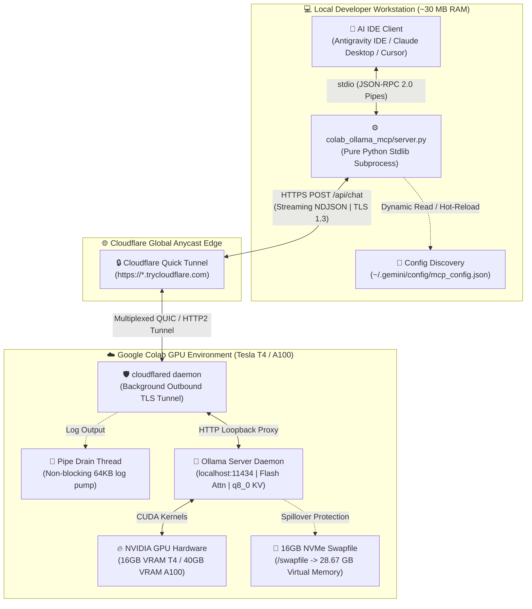
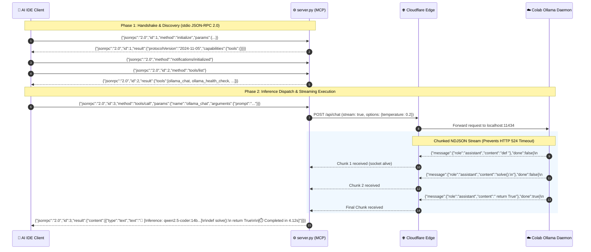

# System Architecture & Technical Specifications

> **Component:** `colab-ollama-mcp`  
> **Protocol:** Model Context Protocol (MCP) `2024-11-05` / JSON-RPC 2.0 over `stdio`  
> **Remote Runtime:** Google Colab GPU (Tesla T4 16GB / NVIDIA A100 40GB)  
> **Network Transport:** Cloudflare Quick Tunnel (Outbound TLS Reverse Tunnel)  
> **Local Footprint:** Pure Python 3.9+ standard library ($\le 30\text{ MB}$ RAM, 0% idle CPU)

---

## 1. Executive Summary & Problem Space

Modern software development increasingly relies on Large Language Models for automated code generation, complex architectural refactoring, and deep debugging. However, developers face a severe infrastructure dilemma:

1. **Commercial Cloud API Quotas & Costs:** Pay-per-token APIs (Claude 3.5 Sonnet, GPT-4o) frequently hit rate limits or exhaust team budgets mid-sprint.
2. **Local Inference Hardware Bottlenecks:** Running state-of-the-art 14B–32B coding models (such as `qwen2.5-coder:14b` or `qwen2.5-coder:32b`) locally requires 10 GB to 22 GB of unified memory. On standard 16 GB–18 GB developer laptops (e.g., Apple Silicon M-series or Linux/Windows laptops), local inference causes intense memory pressure, OS page swapping, thermal throttling, and severe battery drain.
3. **Local IDE Integration Gap:** Conventional remote GPU setups require complex port forwarding, SSH keys, dynamic DNS, or brittle web UIs disconnected from the developer's primary IDE.

**`colab-ollama-mcp`** solves this by establishing a zero-dependency, bidirectional Model Context Protocol bridge between local AI-powered IDEs (Antigravity IDE, Claude Desktop, Cursor) and ephemeral Google Colab GPU instances. 100% of GPU tensor operations and VRAM allocations are offloaded to remote Google Cloud hardware, while the local laptop runs a tiny, non-blocking Python standard library subprocess consuming less than 30 MB of RAM.

---

## 2. End-to-End System Topology



### Component Roles

| Layer | Component | Execution Context | Responsibility |
| :--- | :--- | :--- | :--- |
| **Client** | Antigravity / Claude / Cursor | Local Host | Manages user prompts, file system context, diff application, and tool invocations. |
| **Bridge** | `server.py` | Local Subprocess | Translates MCP JSON-RPC 2.0 requests from `stdio` into HTTP REST payloads; streams NDJSON chunks. |
| **Transport** | Cloudflare Quick Tunnel | Cloud Anycast Edge | Provides public HTTPS ingress without firewall reconfiguration, port forwarding, or public IP addresses. |
| **Agent** | `cloudflared` | Colab Linux VM | Initiates outbound TLS connection to Cloudflare edge; proxies incoming HTTP requests to `127.0.0.1:11434`. |
| **Engine** | Ollama Daemon | Colab Linux VM | Houses model weights in GPU VRAM, executes Flash Attention matrix math, manages KV cache. |

---

## 3. Communication Protocols & Data Framing

The system operates across two distinct network and IPC boundaries: local OS standard input/output (`stdio`) and remote HTTP/1.1 over TLS.



### 3.1. Local Stdio Framing & Pipe Buffering

`server.py` implements a robust, lightweight JSON-RPC 2.0 dispatcher:
1. **OS Kernel Blocking I/O:** The server reads `sys.stdin.readline()` in an infinite loop. When no requests are pending, the OS kernel puts the Python process into sleep mode (`TASK_INTERRUPTIBLE`), consuming **0.0% CPU**.
2. **Buffer Flush Discipline:** Operating systems normally buffer `stdout` in 4 KB to 8 KB blocks when piped to another process. To prevent client-server deadlocks where the IDE waits indefinitely for an incomplete buffer, `server.py` executes an explicit `sys.stdout.flush()` immediately after writing each line:
   ```python
   def send_response(res: Dict[str, Any]) -> None:
       sys.stdout.write(json.dumps(res, ensure_ascii=False) + "\n")
       sys.stdout.flush()
   ```

### 3.2. Cloudflare Reverse Tunneling & NAT Traversal

Traditional self-hosted solutions fail on Google Colab because:
- Colab VMs reside behind Google Cloud carrier-grade NAT (CGNAT) without public IPv4 addresses.
- Inbound ports cannot be opened directly from the external internet.

`cloudflared` circumvents this by establishing **outbound** persistent TLS/QUIC tunnels to Cloudflare Anycast edge servers. Incoming HTTPS traffic hitting `https://<unique-id>.trycloudflare.com` is routed through Cloudflare's private backbone and forwarded down the established tunnel directly to `http://localhost:11434` inside the Colab VM.

### 3.3. HTTP 524 Prevention via Streaming NDJSON

Cloudflare edge proxies enforce a strict **100-second idle gateway timeout (HTTP 524: A Timeout Occurred)**. When large models (such as `deepseek-r1:14b` with extended Chain-of-Thought reasoning or `qwen2.5-coder:32b` generating comprehensive unit test suites) take 60–120 seconds to formulate an answer, a standard synchronous HTTP request often drops.

`server.py` defeats this timeout by enforcing `"stream": True` in all `/api/chat` calls. The remote Ollama daemon dispatches individual token chunks as Newline Delimited JSON (NDJSON):
```text
{"model":"qwen2.5-coder:14b","message":{"role":"assistant","content":"import"},"done":false}
{"model":"qwen2.5-coder:14b","message":{"role":"assistant","content":" os"},"done":false}
```
Because TCP packets traverse the Cloudflare reverse tunnel every few milliseconds, the gateway connection remains perpetually active, eliminating HTTP 524 drops regardless of generation length.

---

## 4. Zero Local RAM Offload Model

The central design guarantee of `colab-ollama-mcp` is **complete compute and memory offloading**.

### Hardware Footprint Comparison

| Architectural Dimension | Local LLM (Ollama Desktop) | Pay-Per-Token Cloud API | Colab Ollama MCP (This Project) |
| :--- | :---: | :---: | :---: |
| **Model Size Capable** | 7B – 8B (Quantized Q4) | 70B+ / Proprietary | **14B – 32B (Q4_K_M / Dense / MoE)** |
| **Local Host RAM Consumption** | **10.5 GB – 14.8 GB** | $\approx 0\text{ MB}$ | **$\le 30\text{ MB}$** |
| **Local CPU / GPU Utilization** | 100% Core Saturation | Negligible | **0.0% GPU / $< 0.1\%$ CPU** |
| **Thermal / Fan Noise** | Severe (Heavy throttling) | None | **None (Silent)** |
| **Monthly Operating Cost** | Free ($0) | High ($50–$300+/month) | **$0 (Free Tier) to $10/month (Pro)** |
| **Privacy & Code Isolation** | Completely Local | Sent to 3rd-Party Vendor | **Isolated Private Colab VM** |

All model weights (8.5 GB for 14B, 19.8 GB for 32B), KV caches, intermediate activation tensors, and CUDA workspace buffers exist exclusively within the Colab GPU High Bandwidth Memory (HBM) and NVMe swapfile. The local host machine merely handles JSON string parsing and network I/O.

---

## 5. Security Architecture & SSRF Defense

Because the MCP server accepts remote endpoint URLs dynamically, rigorous validation is implemented to prevent Server-Side Request Forgery (SSRF) and local network enumeration.

### 5.1. Strict Endpoint Sanitization (`validate_endpoint_url`)

Every endpoint URL passed via CLI (`--set-endpoint`), environment variable (`OLLAMA_ENDPOINT`), or tool argument (`ollama_set_endpoint`) passes through multi-layer verification:

```python
def validate_endpoint_url(url: str) -> Tuple[bool, str]:
    # 1. Reject non-strings and malformed syntax
    # 2. Strict scheme whitelist: https:// or local http://
    # 3. Block file://, ftp://, gopher://, javascript:
    # 4. Block Cloud Metadata IP: 169.254.169.254
    # 5. Block Private RFC-1918 IPv4 ranges:
    #    - 10.0.0.0/8
    #    - 172.16.0.0/12
    #    - 192.168.0.0/16
    # 6. Block Loopback tricks on HTTP (unless explicitly localhost/127.0.0.1)
    # 7. Require valid domain dot-syntax for HTTPS public hosts
```

### 5.2. Safe HTTP Redirect Handler (`_SafeRedirectHandler`)

Standard Python `urllib.request` automatically follows HTTP 301/302 redirects. An attacker could configure a public domain (`https://evil.com`) that issues a 302 redirect to `http://169.254.169.254/computeMetadata/v1/` to extract cloud credentials.

`server.py` installs a custom `_SafeRedirectHandler` across the global `urllib` opener:
```python
class _SafeRedirectHandler(urllib.request.HTTPRedirectHandler):
    def redirect_request(self, req, fp, code, msg, headers, newurl):
        resolved_url = urllib.parse.urljoin(getattr(req, "full_url", ""), newurl)
        is_valid, validation_msg = validate_endpoint_url(resolved_url)
        if not is_valid:
            raise urllib.error.URLError(
                f"Blocked unsafe HTTP {code} redirect to '{resolved_url}': {validation_msg}"
            )
        return super().redirect_request(req, fp, code, msg, headers, newurl)
```
Any attempt to redirect from a public Cloudflare tunnel to an internal network interface or cloud metadata service is trapped and aborted immediately.

---

## 6. Dynamic Configuration & Zero-Restart Hot Reload

Google Colab allocates ephemeral VM instances. When a session disconnects or is restarted, Cloudflare assigns a new randomized URL (e.g., `https://alpha-bravo-charlie.trycloudflare.com`).

Restarting the local IDE or killing active CLI processes to update config files disrupts the developer workflow. `server.py` implements **on-the-fly endpoint resolution**:

1. **Hierarchy of Resolution:**
   - On every incoming `tools/call`, `server.py` re-reads candidate configuration files on disk (`~/.gemini/config/mcp_config.json`, `configs/antigravity_mcp_config.json`).
   - If a new tunnel URL was written to disk, it is picked up immediately without restarting the Python process.
   - Falls back to `--endpoint` CLI arguments or the `OLLAMA_ENDPOINT` environment variable.
2. **Atomic Synchronization (`ollama_set_endpoint`):**
   - When the user runs `--set-endpoint <URL>` or invokes the `ollama_set_endpoint` tool, the server:
     1. Sanitizes the URL via `validate_endpoint_url()`.
     2. Performs an active round-trip ping to verify remote availability.
     3. Atomically updates all detected IDE configuration files (`mcp_config.json`, `claude_desktop_config.json`, `cursor_mcp.json`).
     4. Invalidates the 60-second TTL model cache (`_MODEL_CACHE.clear()`).
     5. Transitions subsequent inference calls to the new endpoint instantaneously.

---

## 7. Exposed Tool Specifications

The MCP server registers four specialized tools:

```text
┌─────────────────────────────────────────────────────────────────────────────┐
│                            MCP TOOL DEFINITIONS                             │
├──────────────────────┬────────────────────────┬─────────────────────────────┤
│ Tool Name            │ Parameters             │ Description                 │
├──────────────────────┼────────────────────────┼─────────────────────────────┤
│ ollama_chat          │ prompt (str, req)      │ Primary inference gateway.  │
│                      │ system (str, opt)      │ Sends code/prompt to GPU    │
│                      │ model (str, opt)       │ and streams response with   │
│                      │ temperature (flt, opt) │ execution latency signature.│
├──────────────────────┼────────────────────────┼─────────────────────────────┤
│ ollama_health_check  │ (none)                 │ Probes tunnel round-trip    │
│                      │                        │ latency (ms), daemon status,│
│                      │                        │ and models pinned in VRAM.  │
├──────────────────────┼────────────────────────┼─────────────────────────────┤
│ ollama_list_models   │ (none)                 │ Fetches all pulled models   │
│                      │                        │ and disk sizes from Colab.  │
├──────────────────────┼────────────────────────┼─────────────────────────────┤
│ ollama_set_endpoint  │ endpoint (str, req)    │ Validates, switches, and    │
│                      │                        │ persists active tunnel URL. │
└──────────────────────┴────────────────────────┴─────────────────────────────┘
```

For detailed protocol implementation and test suites, consult [test_server.py](../tests/test_server.py) and the [Interactive Explainer](explainer.html).
