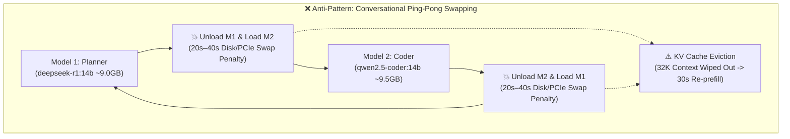
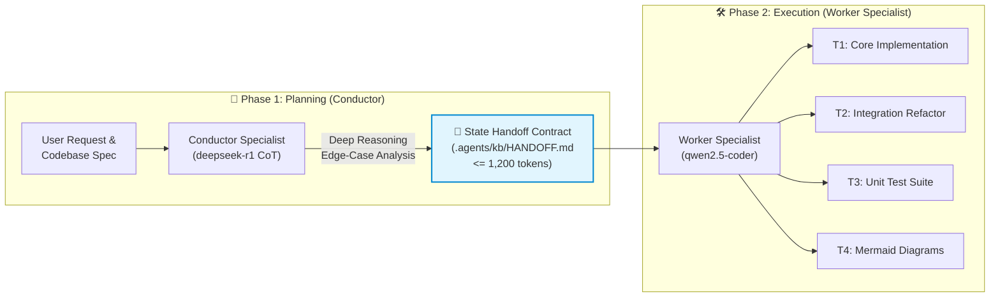
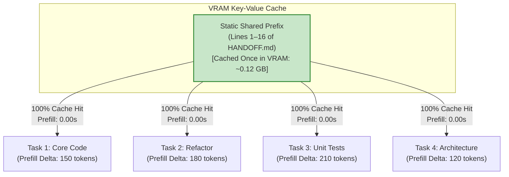

# Conductor & Worker Subagent Protocol

> **Specification:** Conductor-Worker State Handoff Architecture (`ARC-04`)  
> **Target Environments:** Tesla T4 (15.84 GB VRAM) & NVIDIA A100 (40.0 GB VRAM)  
> **Key Objective:** Eliminate model ping-pong swap penalties, preserve KV caches, and enable zero-swap sequential execution.

---

## 1. The Multi-Model Dilemma on Constrained VRAM

Modern agentic workflows often require two distinct cognitive capabilities:
1. **Deep Analytical Reasoning:** Chain-of-Thought (CoT) problem decomposition, security auditing, and architectural planning (best served by reasoning models such as `deepseek-r1`).
2. **High-Precision Code Synthesis:** Syntax accuracy, idiomatic refactoring, test generation, and documentation (best served by specialized coding models such as `qwen2.5-coder`).

However, deploying two 14B-parameter models (`deepseek-r1:14b` and `qwen2.5-coder:14b`) on standard cloud GPU VMs (e.g., Google Colab Tesla T4 with 15.84 GB VRAM and 12.67 GB System RAM) triggers three catastrophic bottlenecks when using naive conversational loops:



### The Three Failure Modes

1. **Host RAM Exhaustion & Disk Trashing:**  
   The combined weight of two 14B models is $\approx 18.5\text{ GB}$, exceeding the Colab VM's 12.67 GB System RAM. When alternating between models, the OS cannot cache both in page memory and is forced to reload multi-gigabyte GGUF tensors from NVMe disk, incurring a **20s to 40s latency penalty per switch**.
2. **Catastrophic KV Cache Eviction:**  
   Whenever Ollama evicts a model from VRAM to make room for another, the active Key-Value (KV) attention cache (up to 32,768 tokens) is discarded. When the original model is reloaded, it must re-compute the attention tensors for the entire historical conversation from scratch (**30s to 45s of re-prefill latency**).
3. **Wall-Clock Compute Unit Waste:**  
   Google Colab charges Compute Units (CUs) based on wall-clock instance uptime (~1.53 CU/hour for T4). An agent that alternates between models 6 times wastes 4 to 6 minutes solely waiting for disk I/O, draining compute budget without generating a single token.

---

## 2. The Conductor-Worker Solution (Decoupled State Handoff)

The **Conductor-Worker Protocol** resolves this by strictly decoupling **Strategic Planning** from **Tactical Implementation**. Instead of passing raw, multi-turn chat transcripts back and forth across model boundaries, the workflow is executed as a unidirectional, single-switch pipeline:



### Role Specialization

- **🎼 Model 1: The Conductor (Architect / Planner)**
  - **Models:** `deepseek-r1:14b` (Plan 1) or `deepseek-r1:8b` (Plan 2).
  - **Cadence:** Invoked **exactly once** at the beginning of a feature or remediation scope.
  - **Output:** Analyzes the prompt using deep Chain-of-Thought (`<think>`) reasoning, assesses architectural constraints, defines exact function contracts, and emits a self-contained **State Handoff Contract** ($\le 1,200\text{ tokens}$).
- **🛠️ Model 2: The Worker Specialist (Implementer / Coder)**
  - **Models:** `qwen2.5-coder:14b` (Plan 1 T4), `qwen2.5-coder:32b` (Plan 1 A100), or `qwen2.5-coder:7b` (Plan 2 T4).
  - **Cadence:** Takes over execution and never delegates back to the Conductor during the feature run.
  - **Behavior:** Ingests only the compact State Handoff and executes all decomposed tasks (`T1` through `Tn`) sequentially.

---

## 3. State Handoff Contract Specification

The State Handoff is an invariant contract stored at `.agents/kb/HANDOFF.md`. It must adhere to strict size and structure constraints:

### Quantitative Constraints

$$
\begin{aligned}
\text{Contract Token Size} &\le 1,200\text{ tokens } (\approx 4.8\text{ KB of UTF-8 text}) \\
\text{Worker Prefill Latency} &< 0.15\text{ seconds } (\text{near-instantaneous}) \\
\text{KV Cache VRAM Footprint} &< 0.15\text{ GB} \\
\text{Model Swaps per Feature} &\le 1\text{ switch } (\text{Conductor } \rightarrow \text{ Worker})
\end{aligned}
$$

### Contract Schema Structure

```markdown
# [STATE HANDOFF] Feature / Scope Name

## 1. Static Shared Context Prefix (Invariant Across Tasks)
- **Objective:** Concise 1-2 sentence definition of the core outcome.
- **Hardware Profile:** Active Plan (Plan 1 / Plan 2) & Target GPU.
- **Target Files:** Explicit list of files modified or created.
- **Global Invariants:**
  - Invariant 1 (e.g., Pure Python 3.9+ standard library; zero third-party dependencies).
  - Invariant 2 (e.g., Strict SSRF IP blocking and custom HTTP redirect validation).
  - Invariant 3 (e.g., Return {"isError": True} on all tool exceptions).

## 2. Pre-Sliced Atomic Task Checklist (Zero Ping-Pong Execution)
- [ ] T1 [Scope: Coding — Core Engine] path/to/target.py:L10-L80
  - Contract: def execute_action(query: str, timeout: int = 180) -> Tuple[bool, str]:
  - Spec: Parse input, validate bounds, implement core logic, catch URLError.
- [ ] T2 [Scope: Coding — Integration] path/to/caller.py:L120-L160
  - Contract: Hook execute_action into the JSON-RPC request dispatcher.
- [ ] T3 [Scope: Workflow — Automated Verification] tests/test_target.py
  - Spec: Unit test suite covering success paths, malformed payloads, and mock timeouts.
  - CLI: python3 -m unittest discover -s tests -v
- [ ] T4 [Scope: Diagram — Architecture Sync] docs/architecture.md
  - Spec: Update sequence diagram to reflect new execution step.

## 3. Typed Interface Signatures
```python
def execute_action(query: str, timeout: int = 180) -> Tuple[bool, str]:
    """Exact signature, arguments, and return types expected by caller."""
    ...
```
```

---

## 4. Static KV Prefix Caching Mechanics

Modern LLM inference backends (llama.cpp and Ollama) optimize attention through **Prefix Key-Value Caching**. When a sequence of input tokens matches the initial tokens of a previously evaluated prompt, the engine bypasses matrix multiplications for that segment and reuses the precomputed attention keys and values directly from GPU VRAM.



By ensuring that **Section 1 (Static Shared Context Prefix)** remains byte-for-byte identical across all Worker tool calls:
1. **Time-to-First-Token (TTFT) Drops to Zero:** The engine skips recalculating the 800-token system context, beginning generation almost instantaneously ($< 150\text{ ms}$).
2. **Context Stability:** The Worker LLM maintains unwavering adherence to project invariants and coding style across distinct files because the prefix never shifts.

---

## 5. Zero-Swap Execution vs. Dual-Residency Modes

Depending on the assigned GPU hardware and active execution plan, the protocol operates in one of two modes:

| Execution Mode | Target Hardware | Conductor Model | Worker Model | Concurrency (`OLLAMA_MAX_LOADED_MODELS`) | Model Swap Latency |
| :--- | :--- | :--- | :--- | :---: | :---: |
| **Plan 1 (Performance T4)** | Tesla T4 (16GB) | `deepseek-r1:14b` | `qwen2.5-coder:14b` | `1` | **$\approx 1.8\text{s}$ (Single Handoff Switch)** |
| **Plan 1 (Performance A100)** | NVIDIA A100 (40GB) | `deepseek-r1:14b` | `qwen2.5-coder:32b` | `2` | **`0.0s` (Dual-Resident VRAM)** |
| **Plan 2 (Fast T4)** | Tesla T4 (16GB) | `deepseek-r1:8b` | `qwen2.5-coder:7b` | `2` | **`0.0s` (Dual-Resident VRAM)** |

### 5.1. Plan 1 on T4 (Sequential Single-Switch with OS Cache Warmup)
Because two 14B models cannot reside concurrently in 15.84 GB VRAM, `OLLAMA_MAX_LOADED_MODELS` is set to `1`. However, because the Conductor runs only once at the beginning, there is **only a single model swap** during the entire feature sprint. Furthermore, the notebook warms up the Linux OS page cache during boot, reducing this single swap from 30s down to **under 2 seconds**.

### 5.2. Plan 2 on T4 & Plan 1 on A100 (Co-Resident Dual-VRAM)
In Plan 2 (T4) and Plan 1 (A100), both models fit inside GPU VRAM simultaneously:
- **Plan 2 (T4):** `deepseek-r1:8b` (5.2 GB) + `qwen2.5-coder:7b` (4.5 GB) + KV Cache (3.0 GB) = **12.7 GB / 15.84 GB VRAM** (80.2% utilization).
- **Plan 1 (A100):** `deepseek-r1:14b` (9.0 GB) + `qwen2.5-coder:32b` (19.8 GB) + KV Cache (5.7 GB) = **34.5 GB / 40.0 GB VRAM** (86.2% utilization).

In these configurations, switching between the Conductor and the Worker happens at **$0.0\text{ seconds}$** with zero model reloading.

---

## 6. Implementation Template

Developers and autonomous agents implementing features under this protocol should base their handoffs on `.agents/kb/HANDOFF_TEMPLATE.md`. For live tasks and progress tracking, refer to `.agents/kb/TASKS.md`.
