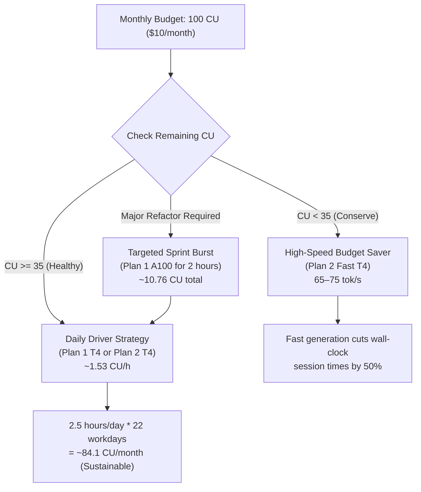
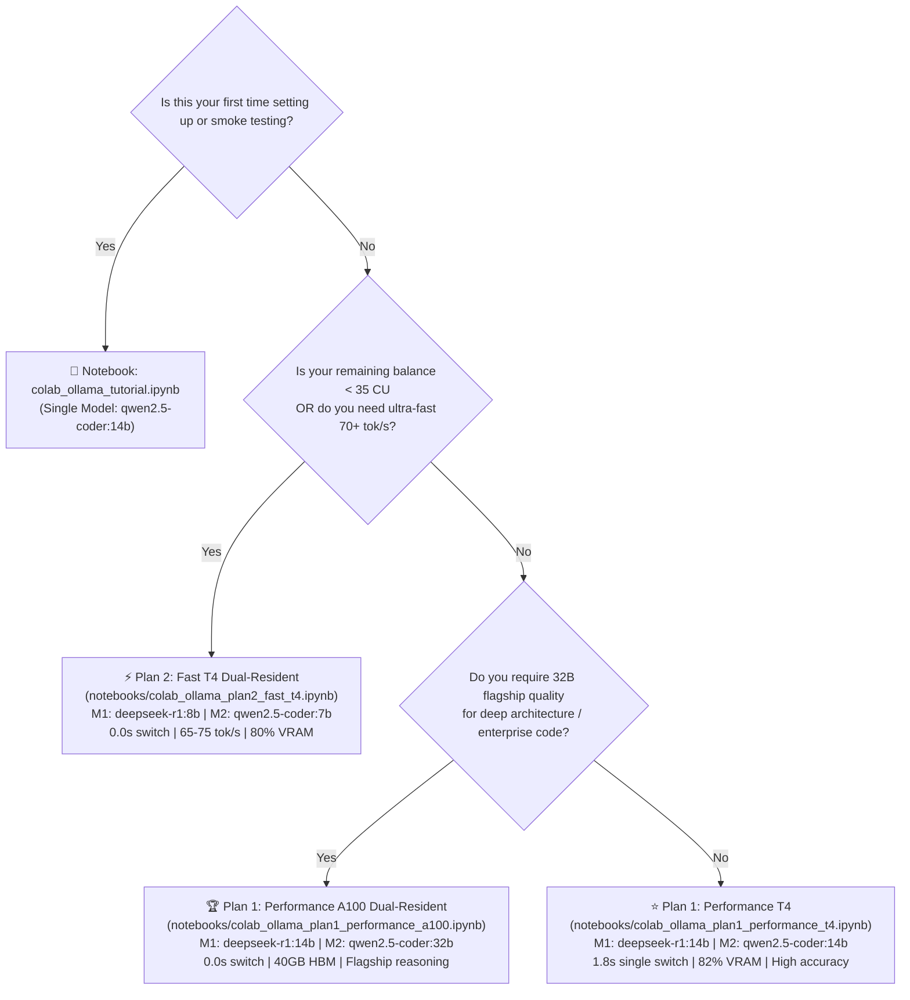

# Model Selection, VRAM Mathematics & Compute Unit Budgeting

> **Scope:** Hardware-Aware Model Selection, Memory Footprint Accounting, and Colab Compute Unit (CU) Pacing  
> **Target GPUs:** Tesla T4 (15.84 GB VRAM) & NVIDIA A100 (40.0 GB VRAM)  
> **Billing Baselines:** Google Colab Pro ($10/month $\rightarrow$ 100 CU) & Google Colab Pro+ ($50/month $\rightarrow$ 500 CU)

---

## 1. Execution Plan Comparison Matrix

`colab-ollama-mcp` provides four structured execution profiles tailored to your available Compute Unit (CU) balance, hardware access, and coding complexity:

| Profile | Notebook Path | Hardware & Rate | Model Pairing (Conductor + Worker) | VRAM Allocation | Switch Latency | Throughput | Best For |
| :--- | :--- | :--- | :--- | :--- | :---: | :---: | :--- |
| **Tutorial** | `notebooks/colab_ollama_tutorial.ipynb` | **Tesla T4 (16GB)**<br>`~1.53 CU/h` | **Single:** `qwen2.5-coder:14b` | 9.5 GB (60%) | N/A | ~35 tok/s | Quick verification, smoke testing, and single-model tasks. |
| **Plan 1: Performance (T4)** | `notebooks/colab_ollama_plan1_performance_t4.ipynb` | **Tesla T4 (16GB)**<br>`~1.53 CU/h` | **M1:** `deepseek-r1:14b`<br>**M2:** `qwen2.5-coder:14b` | 13.0 GB (82%) | ~1.8s (Sequential) | ~35 tok/s | Deep reasoning and production coding when `CU > 35`. |
| **Plan 1: Performance (A100)** | `notebooks/colab_ollama_plan1_performance_a100.ipynb` | **NVIDIA A100 (40GB)**<br>`~5.38 CU/h` | **M1:** `deepseek-r1:14b`<br>**M2:** `qwen2.5-coder:32b`<br>*(or `qwen3-coder:30b` MoE)* | 34.5 GB (86%) | **0.0s** (Dual-Resident) | ~25 tok/s (Dense)<br>~130 tok/s (MoE) | Complex architectural refactoring and large codebases. |
| **Plan 2: Fast (T4 Dual-Resident)** | `notebooks/colab_ollama_plan2_fast_t4.ipynb` | **Tesla T4 (16GB)**<br>`~1.53 CU/h` | **M1:** `deepseek-r1:8b`<br>**M2:** `qwen2.5-coder:7b`<br>*(or `qwen3-coder:8b`)* | 12.7 GB (80%) | **0.0s** (Dual-Resident) | **65–75 tok/s** | Low CU budget (`CU < 35`) or high-speed iterative sprints. |

---

## 2. VRAM Mathematics & Memory Accounting

To guarantee zero Out-Of-Memory (OOM) crashes, total VRAM consumption is calculated across three distinct components:

$$
\text{Total VRAM} = \sum \text{Model Weights} + \text{KV Cache Size} + \text{CUDA Runtime / Workspace Overhead}
$$

### 2.1. The KV Cache Dimension Formula (with `q8_0` Quantization)

For a transformer model with $L$ layers, $N_{kv}$ attention heads, head dimension $D$, context window $C$, batch size $B$, and quantization precision $P_{\text{bytes}}$:

$$
\text{KV Cache (Bytes)} = 2 \times L \times N_{kv} \times D \times C \times B \times P_{\text{bytes}}
$$

With standard FP16 ($P_{\text{bytes}} = 2$), a 16,384 context consumes $\approx 3.22\text{ GB}$ per model.  
By enforcing `OLLAMA_KV_CACHE_TYPE=q8_0` ($P_{\text{bytes}} = 1$), the memory footprint drops by **50%**:

$$
\text{KV Cache}_{q8\_0} \approx 1.61\text{ GB per model at 16K context}
$$

---

### 2.2. Plan 1: Performance on Tesla T4 (Sequential Handoff)

Tesla T4 provides **15.84 GB** usable VRAM. Two 14B models cannot reside concurrently ($9.0\text{ GB} + 9.5\text{ GB} = 18.5\text{ GB} > 15.84\text{ GB}$).  
The notebook sets `OLLAMA_MAX_LOADED_MODELS=1` and warms up the Linux OS page cache:

```text
┌─────────────────────────────────────────────────────────────────────────────┐
│                    PLAN 1 (T4) VRAM ALLOCATION (PEAK LOAD)                  │
├──────────────────────────────────────────┬─────────────────┬────────────────┤
│ Subsystem / Component                    │ Allocation (GB) │ % of 15.84 GB  │
├──────────────────────────────────────────┼─────────────────┼────────────────┤
│ Active Model Weights (qwen2.5-coder:14b) │ 9.52 GB         │ 60.1%          │
│ Quantized KV Cache (q8_0 @ 16K context)  │ 1.61 GB         │ 10.2%          │
│ CUDA Context, Driver & Workspace Buffer │ 1.92 GB         │ 12.1%          │
├──────────────────────────────────────────┼─────────────────┼────────────────┤
│ Total Peak VRAM Consumption              │ 13.05 GB        │ 82.4%          │
│ Remaining VRAM Safety Headroom           │ 2.79 GB         │ 17.6% (SAFE)   │
└──────────────────────────────────────────┴─────────────────┴────────────────┘
```
*Note: `deepseek-r1:14b` is held in warm Linux page cache/NVMe swap. The single handoff switch takes only **~1.8 seconds**.*

---

### 2.3. Plan 2: Fast Dual-Resident on Tesla T4 (`0.0s` Switch)

In Plan 2, both `deepseek-r1:8b` (Conductor) and `qwen2.5-coder:7b` (Worker) remain pinned in VRAM simultaneously (`OLLAMA_MAX_LOADED_MODELS=2`):

```text
┌─────────────────────────────────────────────────────────────────────────────┐
│                 PLAN 2 (T4 DUAL-RESIDENT) VRAM ALLOCATION                   │
├──────────────────────────────────────────┬─────────────────┬────────────────┤
│ Subsystem / Component                    │ Allocation (GB) │ % of 15.84 GB  │
├──────────────────────────────────────────┼─────────────────┼────────────────┤
│ Conductor Model (deepseek-r1:8b Q4_K_M) │ 5.20 GB         │ 32.8%          │
│ Worker Model (qwen2.5-coder:7b Q4_K_M)   │ 4.50 GB         │ 28.4%          │
│ Shared Quantized KV Cache (16K context)  │ 1.80 GB         │ 11.4%          │
│ CUDA Driver & Activation Workspace       │ 1.20 GB         │  7.6%          │
├──────────────────────────────────────────┼─────────────────┼────────────────┤
│ Total Dual-Resident VRAM Pinned          │ 12.70 GB        │ 80.2%          │
│ Remaining VRAM Safety Headroom           │ 3.14 GB         │ 19.8% (SAFE)   │
└──────────────────────────────────────────┴─────────────────┴────────────────┘
```
**Switch Latency: Exactly $0.0\text{ seconds}$** — both models are immediately hot and ready.

---

### 2.4. Plan 1: Performance on NVIDIA A100 40GB Dual-Resident

NVIDIA A100 provides **40.0 GB** of ultra-fast HBM2e memory. Both flagship models reside concurrently in memory:

```text
┌─────────────────────────────────────────────────────────────────────────────┐
│                 PLAN 1 (A100 DUAL-RESIDENT) VRAM ALLOCATION                 │
├──────────────────────────────────────────┬─────────────────┬────────────────┤
│ Subsystem / Component                    │ Allocation (GB) │ % of 40.0 GB   │
├──────────────────────────────────────────┼─────────────────┼────────────────┤
│ Conductor Model (deepseek-r1:14b)        │  9.00 GB        │ 22.5%          │
│ Worker Model (qwen2.5-coder:32b Dense)   │ 19.80 GB        │ 49.5%          │
│ Quantized KV Cache (32K context x 2)     │  3.50 GB        │  8.8%          │
│ Parallel Execution Overhead (NUM_PAR=2)  │  2.20 GB        │  5.5%          │
├──────────────────────────────────────────┼─────────────────┼────────────────┤
│ Total Dual-Resident VRAM Pinned          │ 34.50 GB        │ 86.2%          │
│ Remaining VRAM Safety Headroom           │  5.50 GB        │ 13.8% (SAFE)   │
└──────────────────────────────────────────┴─────────────────┴────────────────┘
```
**Alternative Worker:** Setting the 1-line toggle `USE_QWEN3_MOE = True` swaps the worker for `qwen3-coder:30b` (Mixture-of-Experts), boosting coding generation speed to **~130 tokens/second**!

---

## 3. Compute Unit (CU) Monthly Pacing & Budgeting Guide

Google Colab bills usage by wall-clock runtime measured in Compute Units (CU).

### 3.1. Standard Burn Rates

- **Tesla T4 GPU (Standard Instance):** $\approx 1.53\text{ CU / hour}$ ($\approx \$0.15\text{ / hour}$)
  - A 100 CU package ($10/month) yields **$\approx 65.3$ active GPU hours**.
- **NVIDIA A100 GPU (High-RAM Instance):** $\approx 5.38\text{ CU / hour}$ ($\approx \$0.54\text{ / hour}$)
  - A 100 CU package yields **$\approx 18.6$ active GPU hours**.

---

### 3.2. Pacing Strategies for Developers & Teams



#### Strategy A: The Daily Driver (Sustainable Monthly Pace)
- **Target:** Solo developers coding 2 to 3 hours per day.
- **Hardware:** Tesla T4 (Plan 1 or Plan 2) at $1.53\text{ CU/hour}$.
- **Math:**  
  $$2.5\text{ hours/day} \times 22\text{ workdays} \times 1.53\text{ CU/h} \approx 84.15\text{ CU}$$
- **Outcome:** Fits comfortably within the base $10/month (100 CU) subscription with 15.8 CU left over for unexpected spikes.

#### Strategy B: The 35-CU Threshold Rule (`CU < 35`)
When your Colab account balance drops below **35 CU**, immediately switch your active notebook to **Plan 2: Fast (`colab_ollama_plan2_fast_t4.ipynb`)**:
- Because `qwen2.5-coder:7b` outputs code at **65–75 tok/s** (more than 2x faster than 14B models), the agent completes test runs and refactor loops in half the wall-clock time.
- Halving session duration halves CU burn per task, effectively doubling the lifespan of your remaining units.

#### Strategy C: Targeted A100 Bursts for Deep Architecture
- Reserve the A100 notebook (`colab_ollama_plan1_performance_a100.ipynb`) strictly for **initial system architecture or complex multi-file refactoring**.
- Run an A100 session for **1 to 2 hours** ($5.38$ to $10.76\text{ CU}$) to allow `deepseek-r1:14b` and `qwen2.5-coder:32b` to generate comprehensive scaffolding and tests.
- Once the architecture contract is locked into `.agents/kb/HANDOFF.md`, switch back to Tesla T4 to implement individual modules.

---

## 4. Decision Flowchart: Selecting Your Active Profile



---

## 5. One-Line Notebook Toggles

Each notebook includes clean, single-line configuration flags at the top of the model selection cell to customize behavior without editing shell scripts:

### In `colab_ollama_plan2_fast_t4.ipynb`:
```python
# Toggle Worker model between Qwen2.5 (Default ⭐) and Qwen3 8B (Next-gen):
USE_QWEN3_CODER = False  # False: qwen2.5-coder:7b (~4.5 GB) | True: qwen3-coder:8b (~5.5 GB)
```

### In `colab_ollama_plan1_performance_a100.ipynb`:
```python
# Toggle Worker model between Dense 32B (Default 🏆) and MoE 30B (Ultra-Speed ⚡):
USE_QWEN3_MOE = False  # False: qwen2.5-coder:32b (Dense) | True: qwen3-coder:30b (MoE ~130 tok/s)
```

These toggles allow instant adaptation as new model weights and architectures are released.
